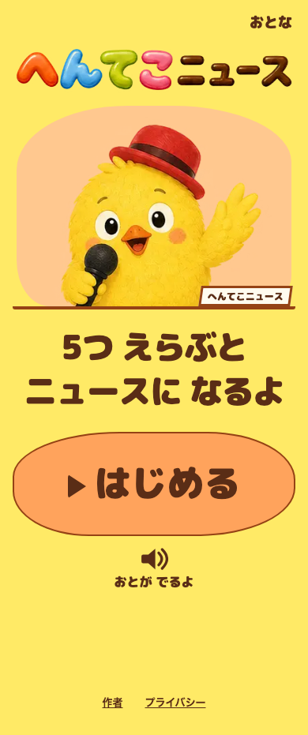
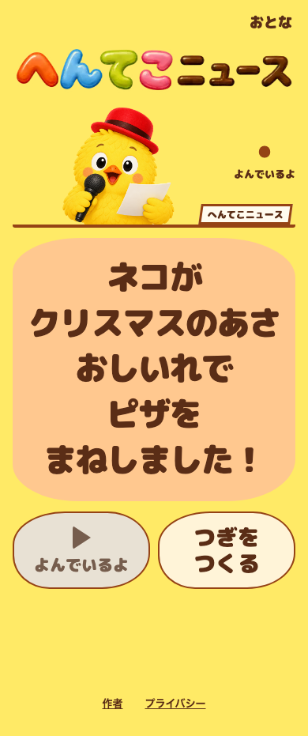

# へんてこニュース

「だれが・いつ・どこで・なにを・どうした」を選んで、へんてこなニュースを作る子ども向けの言葉遊びゲームです。

**[ブラウザで遊ぶ](https://henteko-news.netlify.app/)** — スマートフォン・PC対応、登録不要

| スタート                               | ことばを選ぶ                                   | ニュースの完成                                |
| -------------------------------------- | ---------------------------------------------- | --------------------------------------------- |
|  |  |  |

## 遊び方

1. 「はじめる」を押します。
2. 5つの質問に、表示された選択肢から1つずつ答えます。
3. 完成したニュースを読んだり、読み上げを聞いたりして楽しみます。「つぎをつくる」で何度でも遊べます。

読み上げの利用可否や声は端末・ブラウザによって異なります。音声なしでも遊べます。

## 技術構成

| 用途             | 技術                                                   |
| ---------------- | ------------------------------------------------------ |
| フロントエンド   | React / TypeScript / Vite / CSS                        |
| 読み上げ         | Web Speech API、任意でSupertonic / ONNX Runtime Web    |
| 配信             | Netlify / PWA（オフライン時は文字で利用）              |
| テスト・静的解析 | Vitest / Testing Library / Playwright / Biome / ESLint |

## 開発

Node.jsは[.nvmrc](.nvmrc)で指定したバージョンを使用します。

```bash
git clone https://github.com/AudioStakes/henteko-news.git
cd henteko-news
npm ci
npm run dev
```

`npm run validate` で静的解析・型チェック・単体テスト・ビルドを実行できます。E2Eテストや音声モデルの設定は[開発ドキュメント](docs/DEVELOPMENT.md)を参照してください。

## 利用条件

独自コードは[MIT License](LICENSE)です。画像・音声モデルなどの条件は[利用条件と出所](docs/THIRD_PARTY_NOTICES.md)、アクセス解析については[プライバシーの説明](docs/PRIVACY.md)を参照してください。
