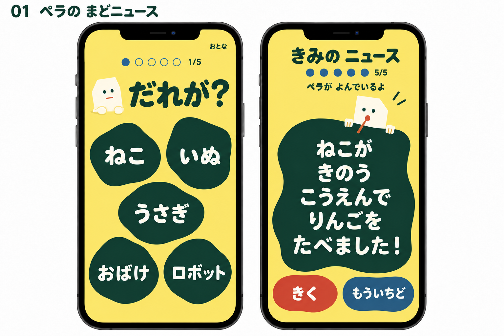
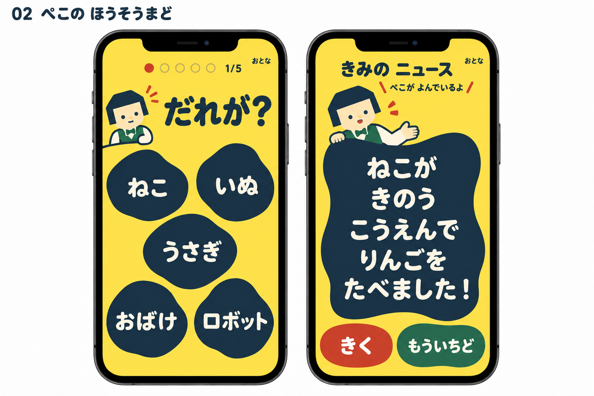
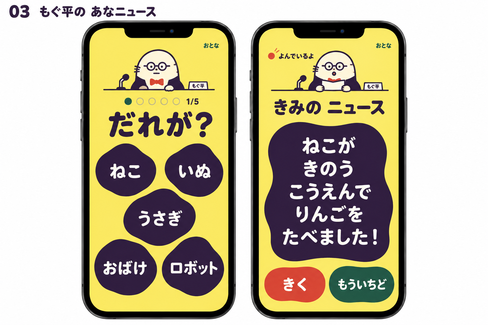
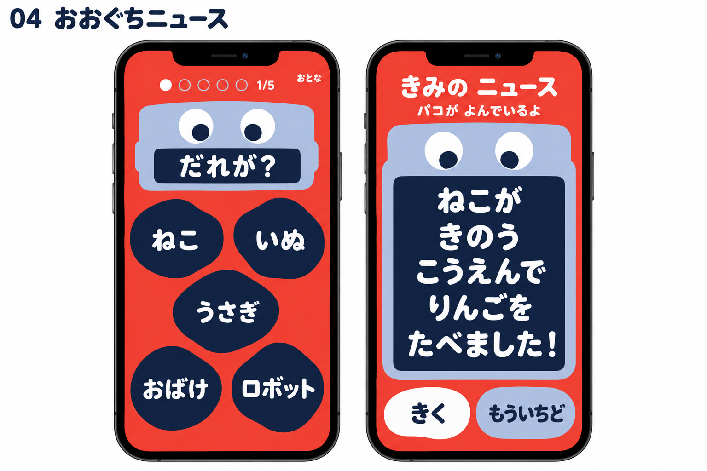
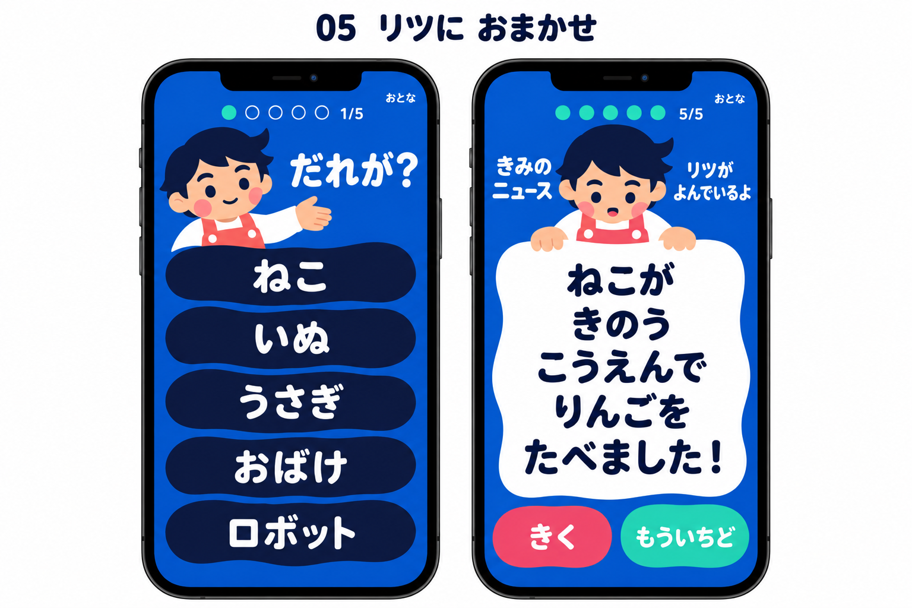
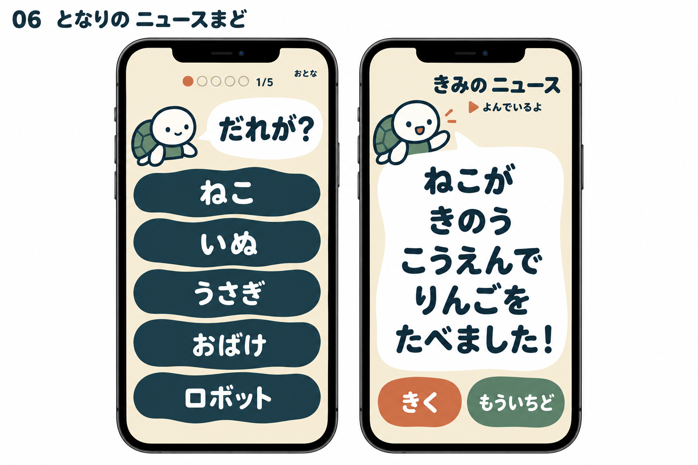

# キャスターが読むUIの比較資料

選ばれた絵本UI「ことばの あな」を出発点に、ニュースキャスターのいる6案を作成した。
今回は実装せず、キャラクター、読み方の見せ方、画面構成を比較するための提案にまとめた。
採用されたのは03「もぐ平」の案。
最新のデザインは、既存ロゴを取り入れ、トップから設定まで展開した[「へんてこニュース」の全画面デザイン案](../ui-full-design/README.md)を参照。
キャラクターを差し替えた段階の[ひよこキャスター版](hiyoko-version.md)も残している。
以下の6案は検討過程として残している。

## 今回の発想の進め方

6人のサブエージェントを、会話履歴を引き継がずに起動した。
それぞれに別のペルソナを設定し、[今回の依頼](brief.md)、[選ばれたベース本文](selected-base.md)、[ベースの静止イメージ](../ui-proposals/images/c.png)、[75項目の要件](../ui-proposals/requirements-only-brief.md)だけを渡した。
既存アプリのコードや画面、他の提案は見せていない。
配色と構図は各提案者に任せ、理由があればベース自体の調整も認めた。

各提案者は自案を見直してから最終化した。
04と05は、別の色とキャラクターの居場所も検討するため第2稿を作成し、初稿も本文の後半に残した。
画像はそれぞれの案をもとに、親エージェントがimagegenの組み込みツールで作った静止イメージである。

## キャスターを加えるためのアイデア

1. **子どもが作り、キャスターが読む。** 内容を決めるのは子ども。キャラクターは、それを大切なニュースとして届ける役にする。「きみの ニュース」と示すと、この関係を画面にも残せる。
2. **穴を放送の窓に読み替える。** 選択の5つの穴が、完成時には読むための一つの大窓になる。窓の縁を持つ、口元と窓をつなぐ、キャラクターの口を窓そのものにするなどの方法がある。
3. **まじめな読み手と、おかしな文章を組み合わせる。** キャラクターの長いギャグを挟まず、自分の選んだ文章を読まれること自体の楽しさを狙う。
4. **口パクより、読む姿勢を明確にする。** 視線、手、口の静止ポーズと「よんでいるよ」で読む役を伝える。音声の準備中は待つ姿とし、実際の開始後に読む姿へ変える。
5. **全文を先に届ける。** キャラクターの登場や音声を待たずに全文を見せる。音が出なくても、完成文と次の遊びを残す。

[組み合わせて使える表現アイデアの詳細](character-direction.md)

## 6つの案を比較する

| 番号 | 案とキャスター                                             | 発想の視点                   | ベースからの主な変更                             | 読む役の伝え方                                                     |
| ---- | ---------------------------------------------------------- | ---------------------------- | ------------------------------------------------ | ------------------------------------------------------------------ |
| 01   | [ペラの まどニュース](01-picturebook.md)／紙のひと「ペラ」 | 仕掛け絵本のキャラクター造形 | 2、1、2の穴を保ち、バター色と黒緑へ。            | 大窓の縁を持つ薄い紙の人。口元から原稿へ短い線をつなぐ。           |
| 02   | [ぺこの ほうそうまど](02-puppet.md)／紙人形「ぺこ」        | 人形劇の演出                 | 麦色と紺。完成窓を人形が持つ舞台枠にする。       | 視線と片手を原稿へ向け、人形が読む舞台として見せる。               |
| 03   | [もぐ平の あなニュース](03-comedy.md)／モグラ「もぐ平」    | 子ども向けコメディ           | 元の穴の配置を保ち、小さな机と名札を加える。     | 丸眼鏡と蝶ネクタイのキャスターが、おかしな内容もまじめに読む。     |
| 04   | [おおぐちニュース](04-toy.md)／およみロボ「パコ」          | SFとおもちゃのデザイン       | 朱赤と青灰色へ。完成の大窓をロボットの口にする。 | キャラクター自身が全文の入る大きな窓。読む主体と文章を一つにする。 |
| 05   | [リツに おまかせ](05-educator.md)／人間の子「リツ」        | 幼児教育と読み聞かせ         | 群青の背景と縦5段の穴へ。                        | 対等な友だちが原稿の縁に手を添えて読み、子どもは作者として残る。   |
| 06   | [となりの ニュースまど](06-inclusive.md)／カメ「トト」     | 認知アクセシビリティ         | 砂色と青緑。幅の広い縦5段へ。                    | 同じ位置にいるカメの口元から、問いと全文の窓をつなぐ。             |

01から03は、元の穴の配置とのつながりを見比べやすい。
04はキャラクターと完成窓の関係を作り替えている。
05と06は、読み手と文字の横幅を確保するため、候補の配置を縦に変更している。
これは変更の方向の説明であり、優劣の順位ではない。

## 01 ペラの まどニュース

薄い紙を切り抜いたような、服も髪もないキャスター。
選択中は問いの横で待ち、完成すると大窓の縁から顔と細い腕を出して読む。
穴の発想をそのままキャラクターの居場所へ広げ、絵本の簡潔な造形を保つ案である。

[一巡、ワイヤー、配色、音声状態、弱点を読む](01-picturebook.md)

## 02 ぺこの ほうそうまど

ベストと蝶ネクタイを着た紙人形のキャスター。
大窓の縁を持つ手と、原稿を見る目で、舞台上の人形が読んでいるように見せる。
役柄が服や仕草にも表れている案である。

[一巡、ワイヤー、配色、音声状態、弱点を読む](02-puppet.md)

## 03 もぐ平の あなニュース

丸眼鏡のモグラが、どんな組み合わせも変わらぬまじめさで読む。
細い机、マイクの小道具、名札が、ニュースを伝える役を示す。
マイクは舞台の道具として描き、録音する操作は増やさない。

[一巡、ワイヤー、配色、音声状態、弱点を読む](03-comedy.md)

## 04 おおぐちニュース

顔を文章の横へ置くのではなく、文章がキャラクターの大きな口に入る案。
選択中の小さな口が問いを示し、完成後は大口に全文が入る。
口は本文の場所なので、話し終わっても閉じず、視線と状態の表示で読む段階を伝える。

[第2稿と、保存した初稿を読む](04-toy.md)

## 05 リツに おまかせ

子どもと対等な相手として、人間の子がニュースを読む案。
上に読み手、下に原稿を置き、横幅を本文に渡す。
「きみの ニュース」と示し、内容を作った人と声にする人を分けて見せる。

[第2稿と、保存した初稿を読む](05-educator.md)

## 06 となりの ニュースまど

いつも同じ場所にいるカメが、問いと完成文を届ける案。
小さな顔と大きな文章の窓を、吹き出しの尾で結ぶ。
落ち着いた色と幅の広い候補を使い、音や派手な演技に頼らず読む役を伝える。

[一巡、ワイヤー、配色、音声状態、弱点を読む](06-inclusive.md)

## 保存した初稿

初稿も別の選択肢として確認できる。
上の画像は04と05については第2稿を表し、初稿の画像は新たに作成していない。

| 案       | 初稿の名前        | キャスターと違い                                       | 全文                       |
| -------- | ----------------- | ------------------------------------------------------ | -------------------------- |
| 04の初稿 | あなから ほうそう | 小型の青緑のパコが、バター色の画面の大窓を両手で持つ。 | [04の後半](04-toy.md)      |
| 05の初稿 | もこに とどける   | 黄土色のモグラが、穴の右上から原稿を見る。             | [05の後半](05-educator.md) |

## 選ぶ際に確認したいこと

- 5歳の子どもが、このキャラクターを「読む人」だと受け取るか。
- キャラクターが気になっても、5候補の見渡しや全文の確認を妨げないか。
- 顔の小ささ、原稿との接続、服や小道具が、役割の理解につながるか。
- 元の2、1、2の穴と縦5段で、長い語の読みやすさや選びやすさがどう変わるか。
- 端末の標準音声とキャラクターの姿が合い、再び読んでもらいたくなるか。
- 読みの習熟度、音の有無、動きを減らす設定によって、理解や楽しさがどう変わるか。

これらはまだ対象児や実機で確認していない。
画像は主な構図とキャラクターの比較用であり、全画面寸法や全状態の仕様図ではない。
細かな状態、長文、操作の条件は各提案の本文と要件を優先する。
候補と完成文の例は比較用で、語彙原本への変更を意味しない。

独立したサブエージェントが、6案の本文と画像を最終レビューした。
ベースとの関係、読む役の分かりやすさ、5候補と全文、音声状態の整合、過剰な追加機能を確認し、重大な修正点は見つからなかった。
このレビューは対象児による実証や、実装の動作確認を意味しない。

[静止イメージの生成プロンプト](visualization-prompts.md)
