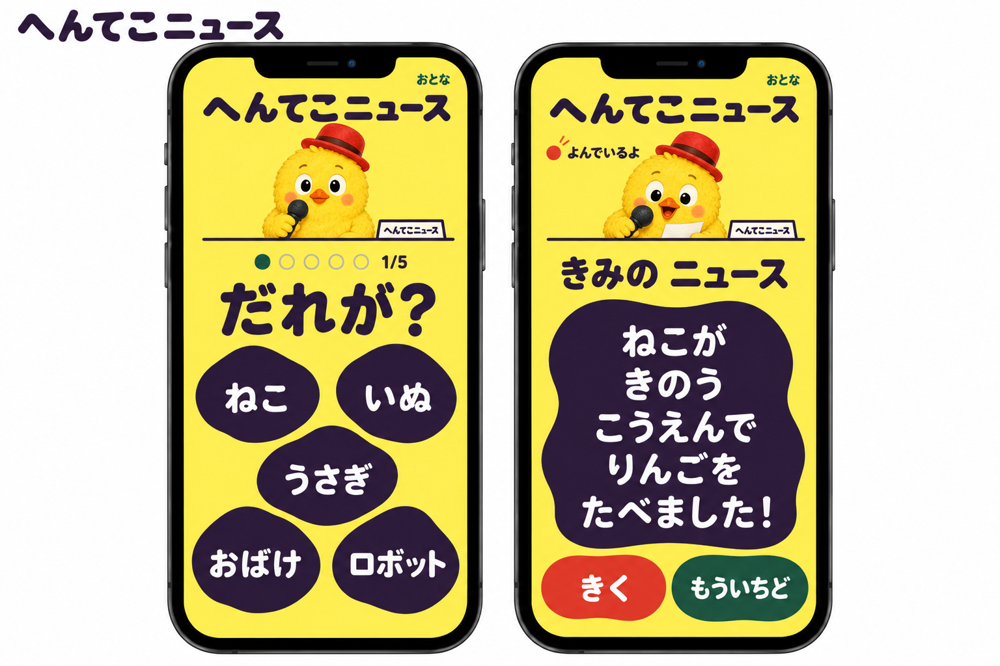

# へんてこニュースのひよこキャスター版

採用された「もぐ平」のUIをベースに、キャスターを既存のひよこへ変更した静止デザイン案。
アプリのタイトルは「へんてこニュース」とする。

既存ロゴの配色を取り入れ、完成画面の「きみのニュース」を削除した最新版は[全画面デザイン案](../ui-full-design/README.md)を参照。
このページの画像は、その前段階の案として残している。



## 変更した点

- 既存キャラクターの黄色い羽毛、赤い帽子、黒いマイク、大きな目を保持した。
- 選択中は待つ姿、完成後は原稿を見て読む姿にした。
- 両画面のタイトルと机の表示を「へんてこニュース」に統一し、「もぐ平」の名前を外した。
- 黄色と濃紫、5候補を上2、中央1、下2に置く構図、完成全文、再生ともう一度の操作を引き継いだ。

アプリへの実装、アニメーション、音声との連動、実機や子どもの操作確認は行っていない。

## 参照素材

- [採用したUI](images/03.png)
- [ひよこの待機姿の参照](../../src/assets/hiyoko8.webp)
- [ひよこの読み上げ姿の参照](../../src/assets/hiyoko5.webp)

## 画像生成の記録

imagegenの組み込みツールで、採用UIを編集対象、既存ひよこ2枚をキャラクターの参照として使用した。
生成画像は `images/03-hiyoko.png` に保存した。

<details>
<summary>使用したプロンプト</summary>

```text
Use case: ui-mockup image edit. Create the requested HENT EKO NEWS chick-caster version of the selected UI.

INPUT ROLES:
Image 1 is the EDIT TARGET: the two-phone UI board with a mole newsreader, yellow background, deep-purple irregular choice holes, and a full-news result window. Preserve its design and interaction structure.
Images 2 and 3 are CHARACTER IDENTITY REFERENCES: the EXISTING original fluffy yellow chick mascot from this project. Use THIS chick, not a newly invented generic chick.

REQUIRED EDITS:
1. Replace the mole caster on BOTH phones with the same existing chick. Preserve the chick's round fluffy bright-yellow body, large white eyes and black pupils, small orange beak, orange/peach round cheek patches, RED rounded brimmed hat with DARK-BROWN band, and BLACK handheld microphone. Retain its soft feather texture and recognizable original proportions. Do NOT turn it into a flat anonymous bird. Do NOT retain the mole's glasses, whiskers, cream face, dark coat or bow tie.
2. The APP TITLE must be exactly "へんてこニュース". Put this clearly at the top INSIDE BOTH phone screens in readable dark-purple Japanese type. Also replace the outside board heading with exactly "へんてこニュース". Remove ALL "03", "もぐ平", "もぐ平の あなニュース" and old mole nameplates from the entire image. If a small caster-desk nameplate is used, it may say "へんてこニュース"; do not invent a mascot name.
3. Keep the chick as a NEWS CASTER at a slim desk, not a new selectable candidate. On the LEFT, a compact front-facing chick waits with beak gently closed or neutral, holding its microphone at chest height, no exaggerated wave. On the RIGHT, the SAME chick reads earnestly, beak slightly open, microphone near its beak, eyes angled toward a small manuscript on the desk or the completed-news window. One wing can rest on the manuscript edge without covering text. The stage microphone formerly used by the mole can be removed because the chick already holds its own microphone. Do not add human hands, headset or extra gadgets.
4. Preserve the yellow flat UI background, deep-purple text/holes, cream labels, coral replay button, green restart button, irregular picture-book silhouettes and overall two-phone composition. The chick is the only softly textured element. Make its cutout clean; NO black or white rectangular background and no halo/checkerboard around the mascot.

LEFT PHONE CONTENT:
Small "おとな", persistent app title "へんてこニュース", the chick caster, five-position progress and "1/5", large question "だれが？", EXACTLY FIVE equally weighted holes in TOP TWO / CENTER ONE / BOTTOM TWO arrangement. Words in reading order: "ねこ", "いぬ", "うさぎ", "おばけ", "ロボット". All five complete and clearly visible. No per-word illustrations, sixth choice, confirm or next button.

RIGHT PHONE CONTENT:
Persistent app title "へんてこニュース", small "おとな", the chick visibly reading, tiny static red reading indicator and "よんでいるよ", section heading "きみの ニュース". One large purple irregular manuscript window with the entire result in these FIVE horizontal Japanese lines in order:
"ねこが"
"きのう"
"こうえんで"
"りんごを"
"たべました！"
Below, keep two large controls "きく" and "もういちど". No text truncation, slash separators, missing words or overlap from the character. News text and all five candidates remain more prominent than decorations.

Create one polished STATIC board with two tall equal phone screens side by side, fully visible on clean white outer space. Leave a little extra vertical space for the new persistent title; modestly rebalance the existing layout without making words tiny. No old studio background, old image logo, old app screenshot, score, timer, new navigation, watermark or extra functionality. This is a design mockup, not an implemented app.
```

</details>
