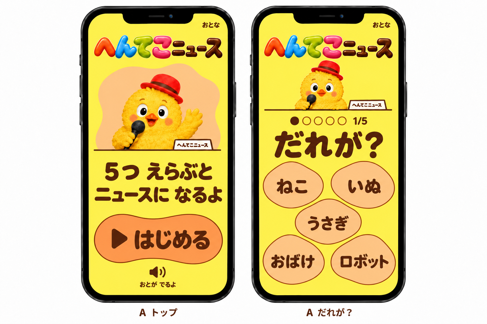
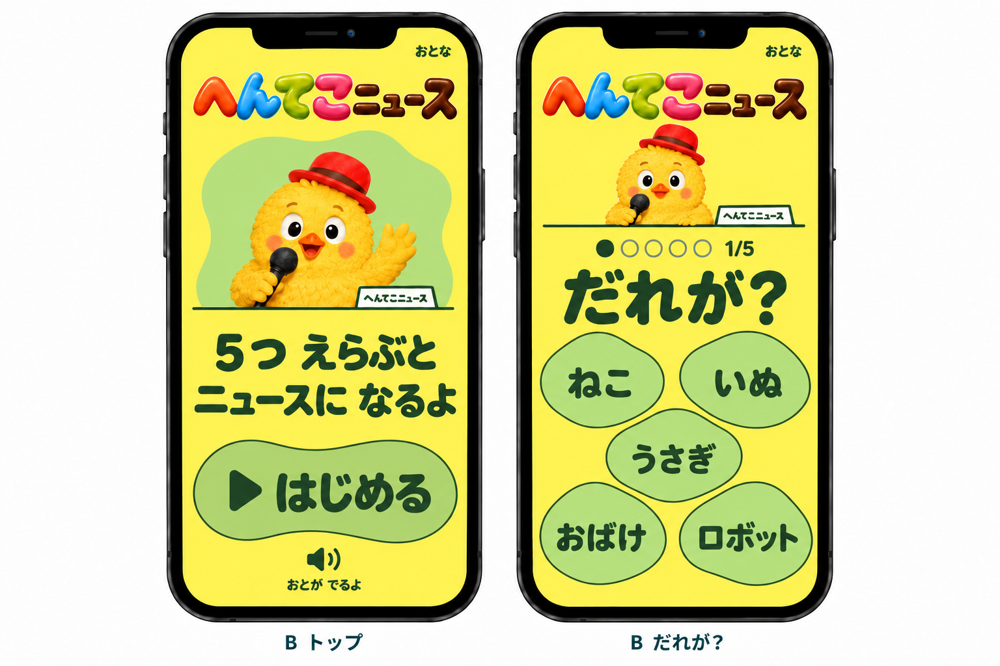
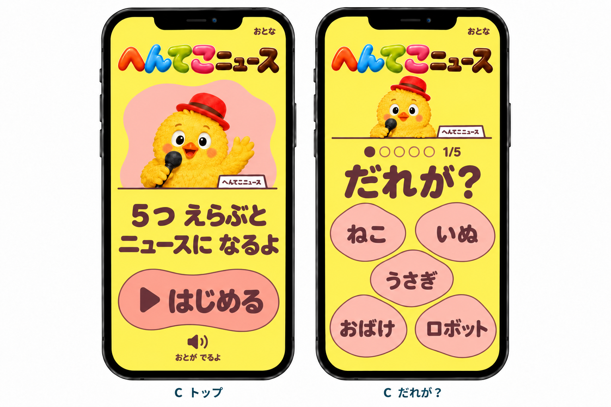
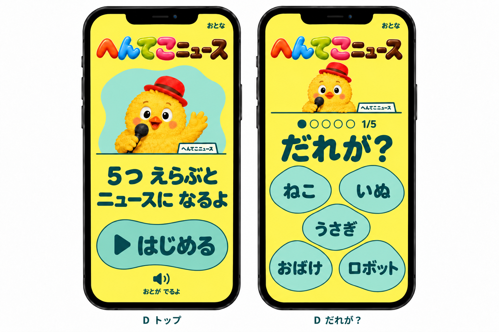
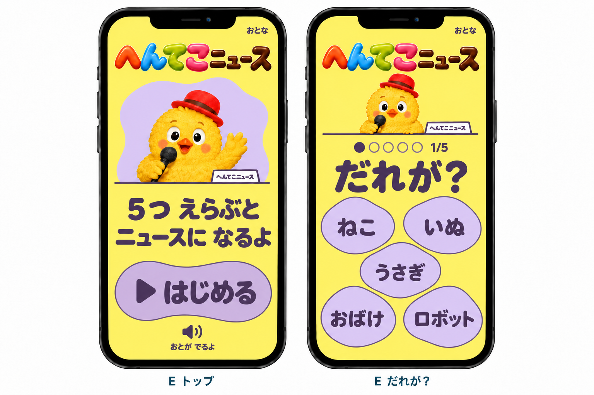
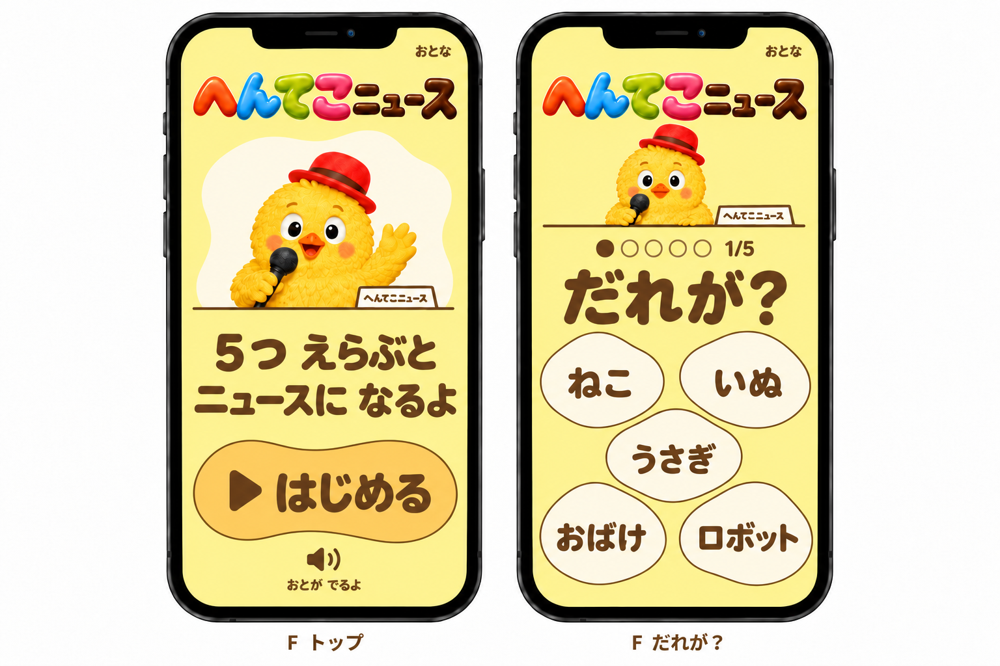

# トップと「だれが？」の配色比較

A「はちみつオレンジ」が採用された。
採用後の展開は[オレンジ版の全画面デザイン案](../ui-full-design/README.md)を参照。

トップと「だれが？」だけを、AからFの6通りの配色で比較する静止デザイン案。
ロゴとひよこの色、2画面の構図、文字、5候補の配置をそろえ、配色を選ぶための資料とした。
比較用の6案はいずれも黄色を基調とし、この資料では各案の2画面だけを作成した。

## A はちみつオレンジ

黄色とアプリコット系のオレンジで、暖かい印象に寄せた案。

## B わかばグリーン

黄色と明るい若葉色を組み合わせた、緑が主役の案。

## C コーラルピンク

黄色にコーラルピンクを合わせ、赤茶色の文字で整えた案。

## D ミントターコイズ

水色よりも緑に寄せた、明るいミント系の案。

## E やさしいライラック

濃い紫の面を使わず、淡いライラックと黄色を組み合わせた案。

## F バターとミルク

淡い黄色とアイボリーを中心にした、色数と彩度を抑えた案。

## 指定色の記録

| 案  | 黄色の背景 | 背面と候補 | 文字      | 輪郭      | はじめる  |
| --- | ---------- | ---------- | --------- | --------- | --------- |
| A   | `#FFEA66`  | `#FFC88F`  | `#5A2D16` | `#954315` | `#FFA35C` |
| B   | `#FFF06A`  | `#B9E280`  | `#23462D` | `#416F39` | `#A8D572` |
| C   | `#FFE978`  | `#FFC2B9`  | `#663A3F` | `#93464D` | `#F4A6A0` |
| D   | `#FFF176`  | `#9FE2CE`  | `#164E4B` | `#246C62` | `#78CFC0` |
| E   | `#FFEC82`  | `#DFCEF4`  | `#51405F` | `#735B89` | `#CFB7E7` |
| F   | `#FFF3AD`  | `#FFFBEA`  | `#6A4A27` | `#8D652A` | `#FFD572` |

指定した単色の組み合わせでは、背景、候補、開始ボタン上の文字はすべて4.5:1以上、輪郭は3:1以上のコントラストを確保する。
生成画像の色には揺れがあり、この数値はPNG全体の適合を検証した値ではない。

画像はimagegenの組み込みツールで作成し、[生成指示](prompts.md)に記録した。
色の好みに関する出典と設計の前提は[調査メモ](../ui-full-design/color-research.md)を参照。
比較元の[水色版の全画面案](../ui-full-design/README.md)も残している。
実装と、実機や子どもによる好みの確認は行っていない。
