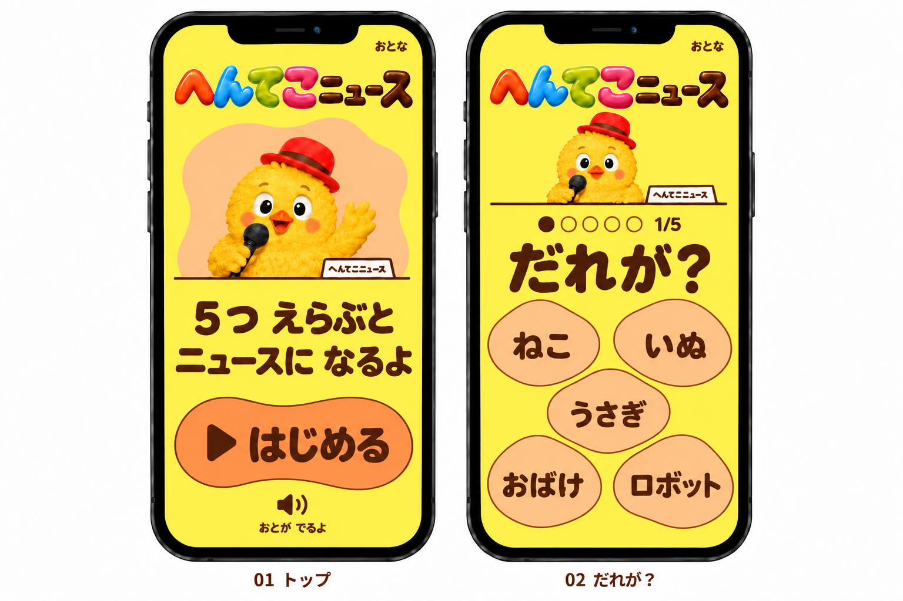
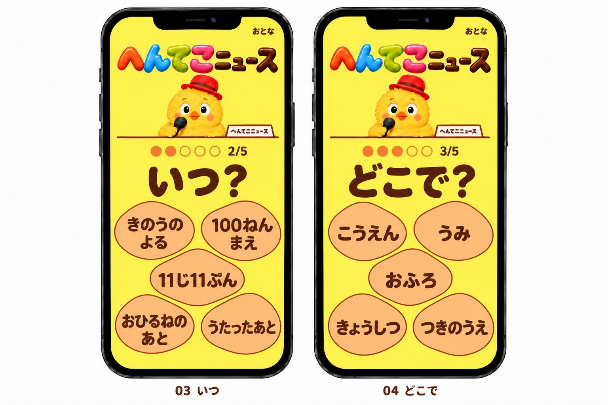
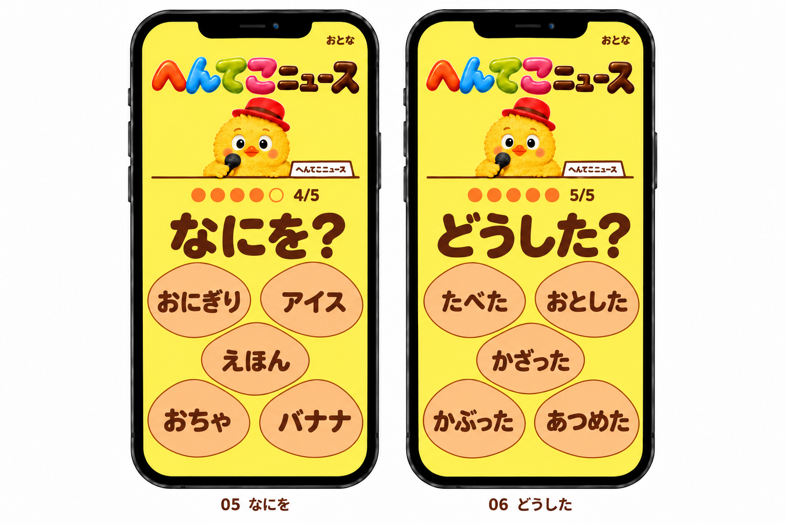
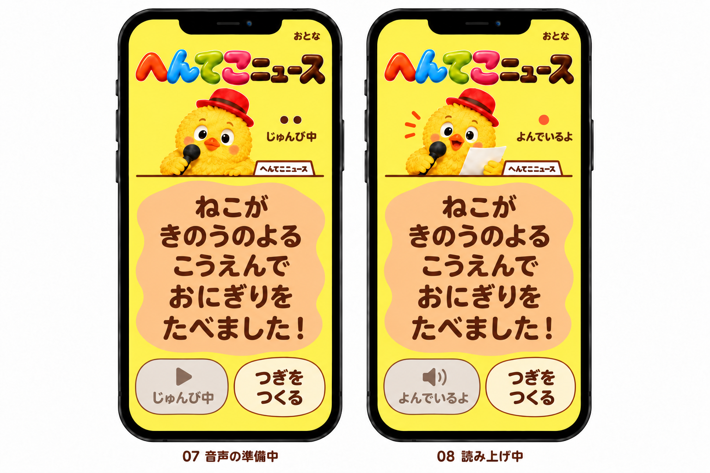
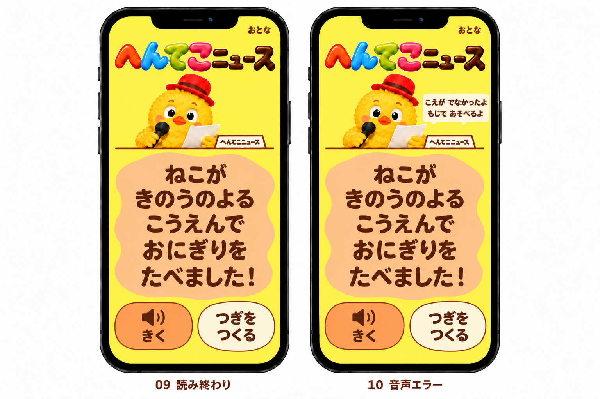
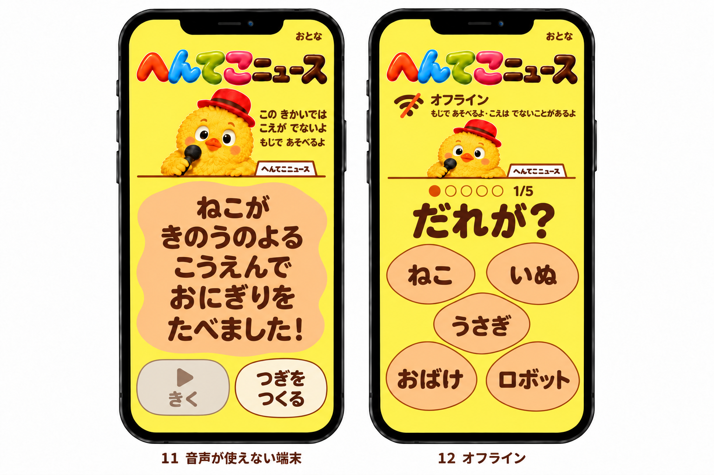
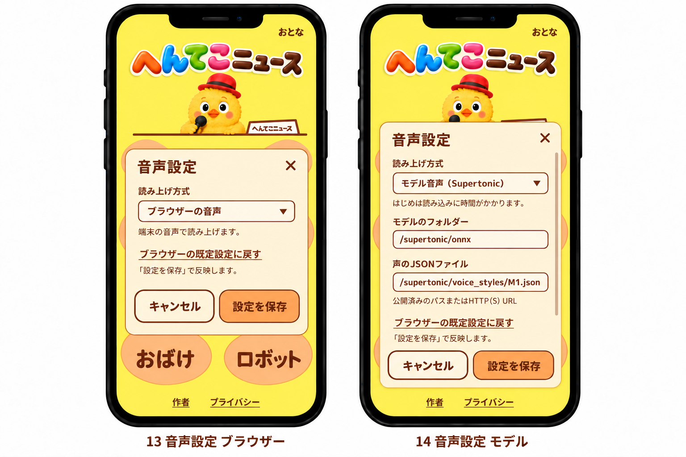
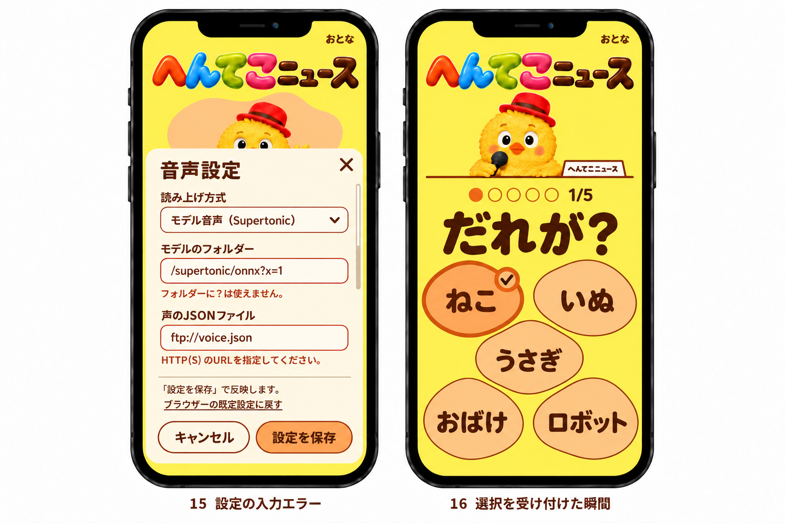
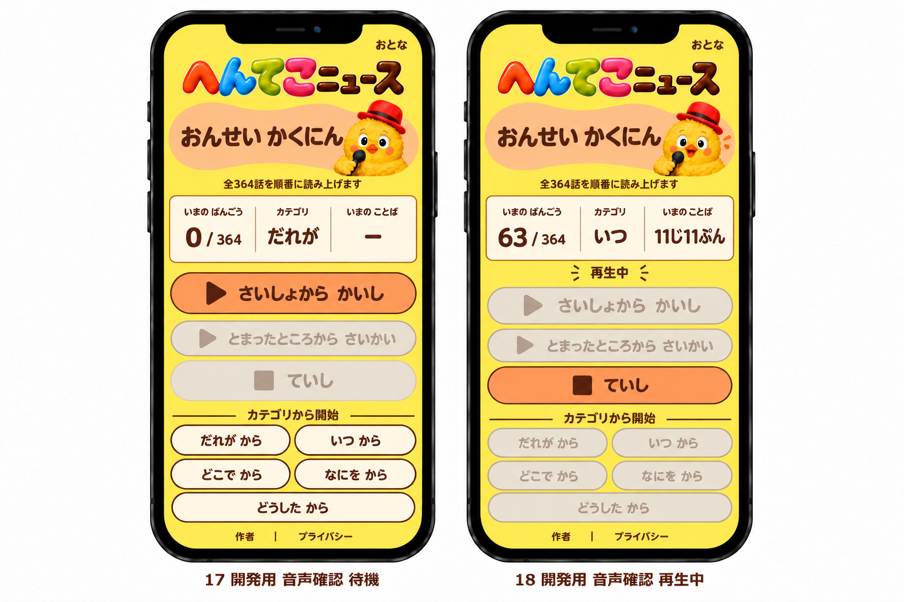
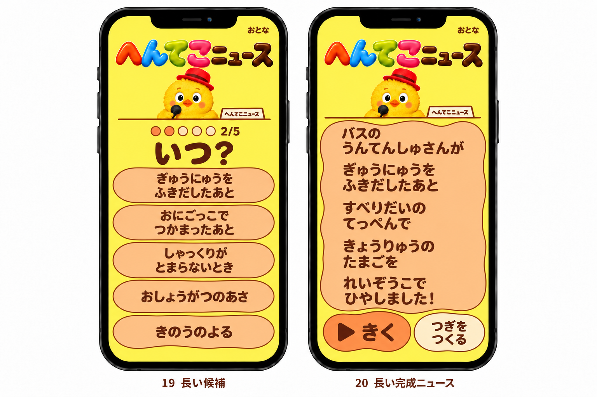

# へんてこニュースの全画面デザイン案

ユーザーが[6パターンの配色比較](../ui-color-variations/README.md)から選んだ[A案](../ui-color-variations/images/a.png)を、全20状態へ展開した静止デザイン案。
採用された[ひよこキャスター版](../ui-caster-proposals/hiyoko-version.md)の構図とキャラクターを保ち、黄色の背景とアプリコットの面へ配色を揃える。
[再設計要件](../ui-redesign-requirements.md)を引き継ぎ、指定された既存キャラクターとロゴの利用、完成画面の見出し削除を反映する。
20の表示例は、開始、5種類の言葉選び、完成、音声設定、開発者向け音声確認の各画面とその状態であり、20ページを新設する提案ではない。
今回の画像生成指示は[A案の生成記録](orange-prompts.md)、配色の比較とA案の選択記録は[配色比較](../ui-color-variations/README.md)に残す。
[水色版](blue-version.md)と[濃紫版](purple-version.md)は過去案として残す。
このページは実装前の静止デザイン資料として残し、現在の実装と検証は[アプリへの反映記録](../ui-implementation.md)を参照。

A案の採用理由はユーザーの選択であり、[子どもの色の好みに関する調査](color-research.md)は水色版の検討時の背景資料として残す。
現在のA案の配色値は次の表を参照。

| 役割                                                     | 色                     |
| -------------------------------------------------------- | ---------------------- |
| 背景                                                     | 黄色 `#FFEA66`         |
| パネルと候補の面                                         | アプリコット `#FFC88F` |
| 文字                                                     | 茶色 `#5A2D16`         |
| 輪郭と縁                                                 | `#954315`              |
| 有効な「はじめる」「きく」「設定を保存」                 | `#FFA35C`              |
| 有効な「つぎをつくる」「キャンセル」と設定ダイアログの面 | `#FFF4D8`              |
| 入力欄                                                   | `#FFFBEF`              |
| 無効な操作の面                                           | `#E8E1D4`              |
| 無効な操作の文字                                         | `#765D4D`              |
| エラー                                                   | `#9A3423`              |

ロゴには[既存の多色ロゴ](../../public/assets/header-logo.webp)を使い、色、文字の形、光沢、縦横比を保つ。
トップでは余白の中で大きく見せ、言葉を選ぶ画面では問題文や候補を圧迫しない大きさにする。
子どもの主な操作は大きなボタンで示し、「おとな」は設定への控えめな入口とする。

## 01 開始と02「だれが？」

開始画面では、ロゴ、子どもを迎えるひよこ、短い遊び方、「はじめる」を順に見せる。
開始すると前回の選択と音声エラーを消し、最初の5候補を表示する。
通常の選択肢は上2個、中央1個、下2個の穴に置き、5個を同じ重さで扱う。
質問と5段階の進行を示し、候補を一つ押すと追加の確定操作なしで次へ進む。

## 03「いつ？」と04「どこで？」

質問、進行表示、5個の穴を同じ位置に保ち、選ぶ種類だけを切り替える。
ひよこは小さく待機し、候補の文字と押せる領域を優先する。
すでに選んだ言葉と現在の段階は、設定の開閉でも保持する。

## 05「なにを？」と06「どうした？」

最後まで同じ操作で5種類を選べる構成とし、種類ごとの追加操作は設けない。
最後の選択後に全文を表示し、その内容の読み上げを始める。
「どうした？」の候補は「たべた」のような表記を保ち、完成文の表示と音声は対応する読みと変換規則に従って「たべました！」とする。

## 07 音声の準備中と08 読み上げ中

完成画面の「きみのニュース」は削除し、代わりの見出しを置かず、空いた領域を全文の表示に充てる。
選んだ5種類を全文で見せ、ひよこや操作ボタンを文章に重ねない。
音声の準備中は「じゅんび中」と待機姿を示し、実際に声が出ている間だけ「よんでいるよ」と読む姿に切り替える。
設計時の実装では準備と読み上げをまとめて扱っていたため、この区別を音声状態へ接続することを実装条件とした。

「きく」は準備中と読み上げ中に無効にし、音声処理を重ねない。
「つぎをつくる」はどちらの状態でも使え、押すと古い音声と処理を取り消して次の「だれが？」へ進む。
全文は最初から表示し、音声開始前の口の動きや、一行ずつ強制的に見せる演出は加えない。

## 09 読み終わりと10 再試行できる音声エラー

読み終わるとひよこは待機姿へ戻り、「きく」で同じニュースを再生できる。
音声に失敗しても全文を残し、短いエラー文と再試行できる「きく」を示す。
エラーと読み上げ状態を同時に通知せず、「つぎをつくる」で遊びを続けられるようにする。

## 11 音声非対応と12 オフライン

音声を利用できない状態では、その理由を短く示し、使えない「きく」と使える「つぎをつくる」を区別する。
設定した音声方式を無断で切り替えず、文字だけでもニュースを完成させられるようにする。
オフライン通知は開始、選択、完成、設定、開発者向け確認のすべてで表示でき、通信が戻れば更新する。
初回のオンライン利用で必要なファイルを保存した後は文字のゲームを続けられるが、オフラインでの音声利用は保証しない。

## 13 ブラウザー音声と14 Supertonicの設定

大人向け設定は、音声方式、モデルのフォルダー、声のJSONファイルの3項目に絞る。
方式は「ブラウザー」と「Supertonic」から選び、モデル指定の初期表示は `/supertonic/onnx` と `/supertonic/voice_styles/M1.json` とする。
速度、音高、音量の編集欄は追加しない。

「設定を保存」で初めて変更を適用し、「キャンセル」、閉じる「×」、Escapeでは未保存の編集を捨て、開く前のゲーム状態へ戻る。
「ブラウザーの既定設定に戻す」も編集中の値を戻す操作とし、適用には「設定を保存」を必要とする。
保存した設定は同じブラウザーで復元し、通常のゲームと開発者向け音声確認で共有する。

## 15 設定の入力エラーと16 候補を押した状態

入力エラーは該当する欄の近くに理由を示し、スクロールして全項目と保存、取消へ到達できる構成にする。
モデル指定は前後の空白を除き、公開済みの相対パス、`/`で始まるパス、HTTP(S) URLを受け付ける。
空値、HTTP(S)以外のURL、`#`を拒否し、モデルフォルダーでは `?` も拒否するが、声のJSONでは `?` を許容する。
入力形式が正しいことと、実際にモデルや声を取得できることは別に扱う。

候補を押した状態は穴や縁の変化で短く伝え、色だけに依存しない。
連打で複数の段階を飛ばさず、装飾のための待機や追加の確定ボタンは設けない。

## 17 音声確認の待機中と18 連続再生中

`/words-audio-check` は開発者向けの直接URLとして残し、子どもの遊びのナビゲーションには追加しない。
全364語を対象に、「最初から」「続きから」「停止」と5種類それぞれの先頭から始める操作を用意する。
通し番号と総数、種類、現在の語、エラーを読み取れるようにする。
連続再生中の再生操作は「停止」だけを有効にし、停止やエラー後は該当語から再開できるようにする。
完走後は再開位置を先頭へ戻し、通常画面と共有する設定を使う。

## 19 長い候補と20 長い完成文

長い候補では通常の穴の配置を例外として、幅の広い帯を1列に5個並べ、文字を折り返す。
候補数は5個のまま保ち、省略記号や極端な縮小で収めない。
長い完成文でもすべての語と文末を表示し、必要な縦スクロールで「きく」と「つぎをつくる」へ到達できるようにする。
低い横画面でも自然なスクロールを使い、ひよこ、通知、固定操作を本文に重ねない。

## 実装時に確認する条件

作者とプライバシーへのリンクは各画面から到達できる位置に残す。
子どもの画面では本文の後に置くため画像の表示範囲外となることがあり、設定と開発者向け画面では下部に表示する。
操作領域は少なくとも44×44 CSS pxを将来の受け入れ条件とし、間隔と文字の大きさは実機と子どもの操作で確かめる。
静止PNGだけでは操作領域の寸法や操作性の達成を判定しない。

装飾の動きは控えめにし、OSの「動きを減らす」設定に従う。
実装ではボタンと入力の意味、ラベル、見えるフォーカス、画面遷移時の通知を保ち、設定内のフォーカス管理と閉じた後の復帰も確認する。
キーボードと支援技術での操作、コントラスト、セーフエリアへの対応は、画像では検証できない設計条件として残す。

この静止デザインの作成時点では、アプリへの実装、音声連動、実機、子どもによる操作確認は行っていなかった。
生成画像の文字はモックアップであり、実装ではロゴを描き直さず元の画像素材を直接使用する。
