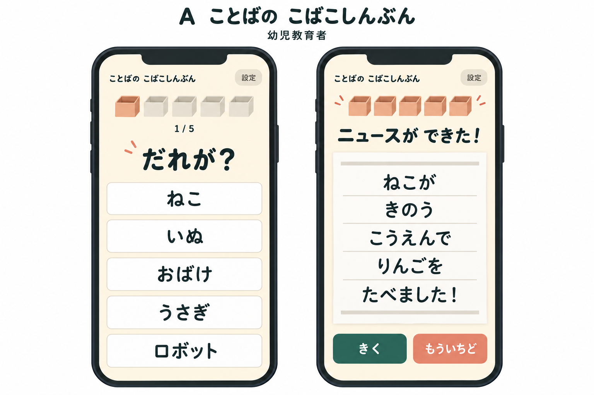
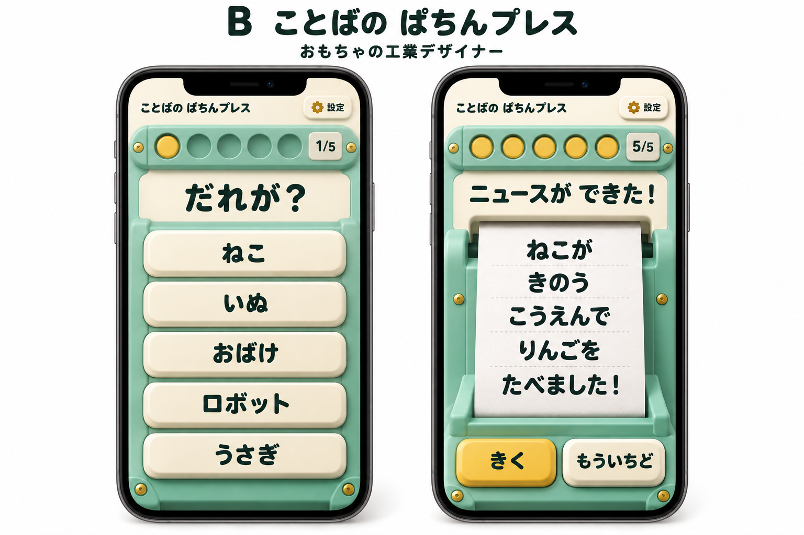
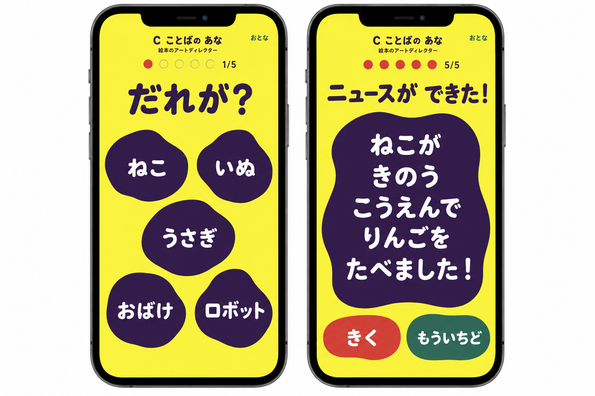
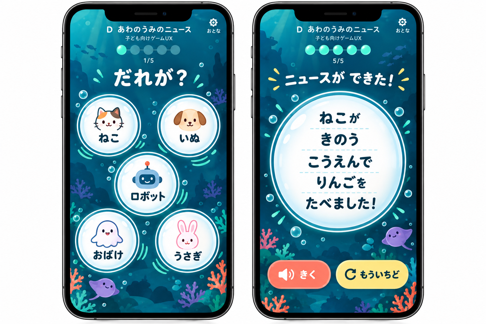
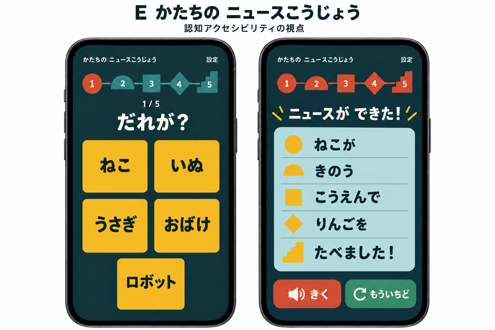
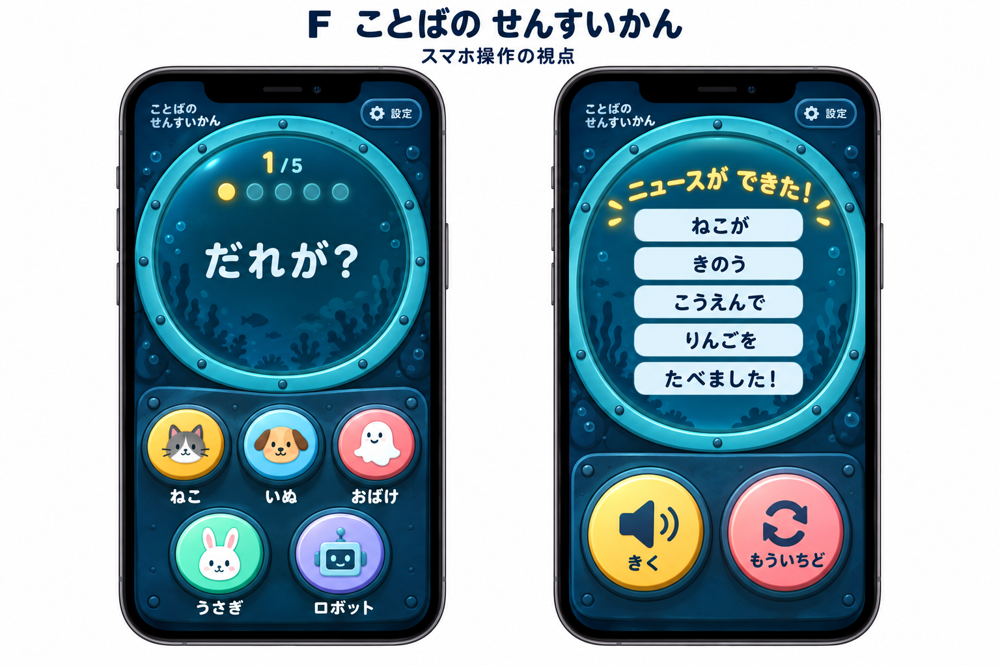

# 5歳向けスマホUIの比較資料

6人のサブエージェントが、異なるペルソナの視点から独立して考えたUI案を比較する。
採用案は決めていない。
各案の静止画と、遊び方、見た目、弱点を見て選べるようにした。

## 発想の条件

- 全員を会話履歴の継承なしで起動した。
- 入力は[要件専用資料](requirements-only-brief.md)だけとし、既存アプリのコード、画面、画像、過去の会話は参照させていない。
- 元の[要件一覧](../ui-redesign-requirements.md)の75項目をすべて含めつつ、既存の見た目を連想させる固有名、素材名、ソースへのリンクを入力から除いた。
- 各デザイナーには別の提案を見せていない。
- C、D、E、Fは自分の初稿を再検討し、第2稿も作成した。初稿は削除せず、各ファイルの後半に全文を保存した。
- アプリ、動くプロトタイプ、HTML画面は実装していない。以下の画像は、各提案をもとに親エージェントがimagegenの組み込みツールで作った静止イメージである。

ペルソナは発想の視点を表す。
対象児や実際の専門家による評価を得たという意味ではない。

## 6つの最終案

| 案  | 発想の視点             | 名前                                          | 選ぶ楽しさ                                               | 完成の見せ方                                             | 主に確かめたいこと                                 |
| --- | ---------------------- | --------------------------------------------- | -------------------------------------------------------- | -------------------------------------------------------- | -------------------------------------------------- |
| A   | 幼児教育               | [ことばの こばこしんぶん](a-educator.md)      | 言葉を小箱に一つずつしまう。5候補は縦一列。              | 5箱が揃い、自分の新聞が広がる。                          | 小箱が進行の合図として伝わるか。                   |
| B   | おもちゃの工業デザイン | [ことばの ぱちんプレス](b-toy.md)             | 厚い押し部品が、ぱちんとはまる。5候補は縦一列。          | 工作台から厚紙のニュース札が出る。                       | 画面上の押す感触を楽しめるか。                     |
| C   | 仕掛け絵本の表現       | [ことばの あな](c-picturebook.md)             | レモン色の面にある5つの濃紫の穴を選ぶ。上2、中央1、下2。 | 穴が一つの大きな窓になり、文章が現れる。                 | 中央への選択の偏りや、強い色への反応。             |
| D   | 子ども向けゲームUX     | [あわのうみのニュース](d-game.md)             | 海に浮かぶ5つの泡をつつく。上2、中央1、下2。             | 泡がまとまり、大きなニュースの泡になる。                 | 泡の配置と動きが楽しさにつながるか。               |
| E   | 認知アクセシビリティ   | [かたちの ニュースこうじょう](e-inclusive.md) | 大きな積み木を選ぶ。2列、2列、中央1個。                  | 5つの形と全文が一つの面に組み上がる。                    | 形と段階の対応が助けになるか、負担になるか。       |
| F   | スマホのタッチ操作     | [ことばの せんすいかん](f-mobile.md)          | 下部の5スイッチを押す。上3、下2の浅い操作盤。            | 上部の丸窓に全文が浮かぶ。下部は再生と繰り返しに変わる。 | 長い語でも各スイッチに届き、読み間違えず選べるか。 |

## A ことばの こばこしんぶん

「自分で選んで、ひとつしまえた」を繰り返す案。
空箱が埋まることで進行を見せ、候補は同じ大きさの札で落ち着いて選ぶ。
大きな変化や刺激より、選択と完成のつながりを重視する。

[開始からの流れ、ワイヤー、色、弱点を読む](a-educator.md)

## B ことばの ぱちんプレス

スマホを小さな工作台に見立てる案。
押し部品の沈み込みと、5穴の台座にはまる変化が特徴。
最後は機械から出たニュース札を読み、すぐ次の制作へ進める。

[開始からの流れ、ワイヤー、色、弱点を読む](b-toy.md)

## C ことばの あな

画面全体を使う、平らで大胆な色面の案。
不揃いな穴から言葉が浮き上がるように見せる。
新聞やおもちゃの機械を模さず、5つの穴が一つの窓になる変化で完成を伝える。

[第2稿と、保存した初稿を読む](c-picturebook.md)

## D あわのうみのニュース

海に浮かぶ泡をつつきながら言葉を選ぶ案。
波紋や景色の小さな変化と、完成時に泡がまとまる変化を楽しむ。
絵や動きは候補の文字を邪魔せず、動きを減らしても成立させる。

[第2稿と、保存した初稿を読む](d-game.md)

## E かたちの ニュースこうじょう

色面と幾何学形を使い、選んだ順番を形でもたどれる案。
候補は同じ黄色と寸法で提示し、色や見た目による正解を作らない。
形が組み上がる喜びを狙いながら、点滅や強い動きには頼らない。

[第2稿と、保存した初稿を読む](e-inclusive.md)

## F ことばの せんすいかん

上を大きな表示窓、下を親指で押す操作盤にする案。
5つのスイッチで言葉を選ぶと窓の灯りが増え、最後に文章が現れる。
世界観に加え、指を動かす範囲を他案から変えている。

[第2稿と、保存した初稿を読む](f-mobile.md)

## 保存した4つの初稿

初稿も選択肢として残している。
以下は文章とワイヤーで確認できる。
上の6枚の画像は、AとBの提案およびCからFの第2稿を示す。

| 番号 | 名前                        | 特徴                                                                     | 全文                        |
| ---- | --------------------------- | ------------------------------------------------------------------------ | --------------------------- |
| C0   | しろいページの とくべつごう | 余白の広い紙面と細い手描きの枠。言葉を見つけるたびに一枚の特別号になる。 | [Cの初稿](c-picturebook.md) |
| D0   | ぽん！ことばプリント        | 印刷機の窓へ言葉を入れ、最後に一枚のニュースを印刷する。                 | [Dの初稿](d-game.md)        |
| E0   | もこもこ ことばびん         | 布の輪郭と縫い目。言葉のクッションを選んで、穏やかな通信にする。         | [Eの初稿](e-inclusive.md)   |
| F0   | ことばの ぱちんスタンプ     | 縦に並ぶ5候補を押し、紙にスタンプ跡を残してニュースを作る。              | [Fの第1稿](f-mobile.md)     |

## どの案でも保つ条件

- 5種類を決められた順に選び、各段階の5候補から1タップで自動進行する。
- 全364語、助詞、読み、動作の丁寧な過去形を保持する。文章を短い候補ラベルの連結だけで作らない。
- 完成時の全文表示と自動読み上げ、再生、もう一度を維持する。
- 音声や画像が失敗しても文字で遊べ、初回保存後のオフラインにも対応する。
- 長い語や小画面では省略や切り取りを避け、必要な縦スクロールを認める。
- 音声設定、プライバシー、PWA、公開条件、開発用の確認機能を失わない。
- 採点、時間制限、収集、課金などを新設しない。

各画像は世界観と主な構図を比較するためのイメージであり、全状態、長文、設定、各画面寸法への対応を描き切った仕様図ではない。
細部は各提案の本文と要件一覧を優先する。
画像に使う候補と完成例は説明用であり、語彙原本の変更を意味しない。
候補の補助絵は全語で制作済みという前提ではなく、読みが難しい子には保護者の読み添えが残り得る。

楽しさ、読みの習熟差と音の有無による理解、タップのしやすさは、試作後に子どもと実機で確かめる必要がある。
現時点では、どの案の効果も実証していない。

[画像生成に使用したプロンプト](visualization-prompts.md)
